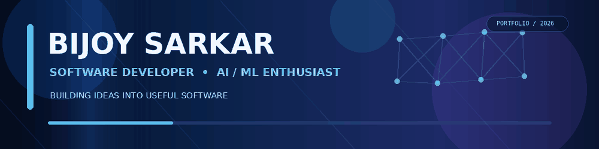
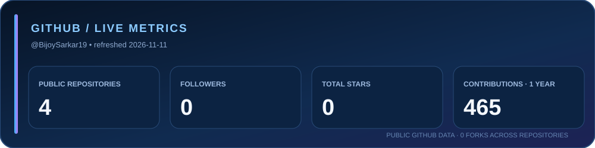
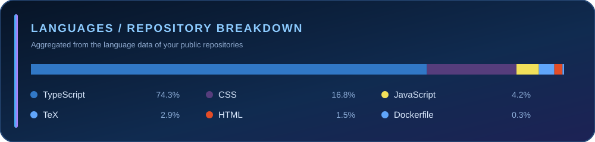
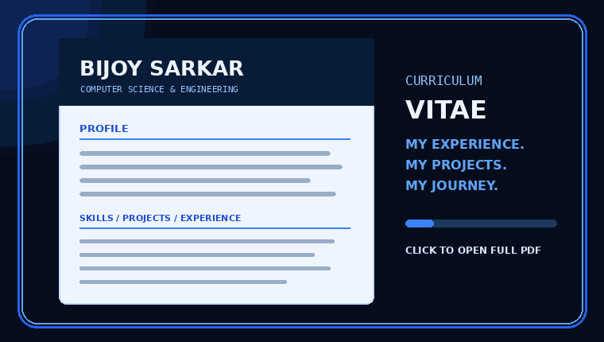
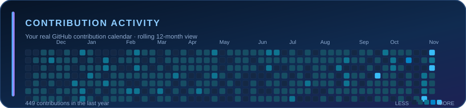

<table>
<tr>
<td width="30%" valign="top">

### BIJOY SARKAR

**B.Tech CSE Student**  
ICFAI University Tripura

My profile photo stays in sync with my GitHub avatar.

---

### CURRENT FOCUS

- Data Structures & Algorithms
- Applied AI / ML
- Computer Vision & NLP
- Scalable software development

### OPEN TO

Software Developer · Python Developer · AI/ML Intern · Full-Stack Developer · Entry-Level Roles · Internships · Collaborations · Open Source

</td>
<td width="70%" valign="top">

## HELLO, WORLD! 👋

I'm **Bijoy Sarkar**, a Computer Science & Engineering student who enjoys turning ideas into practical software. I work across AI/ML, computer vision, NLP, web development and mobile applications.

I believe in learning by building: experimenting with technologies, solving real problems and improving every project through iteration.

### LIVE GITHUB SNAPSHOT

</td>
</tr>
</table>

---

## MY TECH STACK

**Programming languages**

**AI / Machine Learning / Data**

**Web / App / Database / Tools**

---

## FEATURED PROJECTS

<table>
<tr>
<td width="50%" valign="top">

### 🛡️ Rakshak-AI
AI-powered health assistant with conversational assistance, BMI calculation, speech recognition, text-to-speech and local data storage.

`Python` `Llama 3.2` `LM Studio` `Tkinter` `SQLite`

</td>
<td width="50%" valign="top">

### 🛰️ Road Segmentation
Computer-vision project focused on identifying and segmenting roads from satellite imagery.

`Python` `Jupyter` `Computer Vision` `Kaggle`

</td>
</tr>
<tr>
<td width="50%" valign="top">

### 👁️ Smart Attendance System
Face-recognition-based attendance workflow designed to automate attendance recording.

`Python` `OpenCV` `Face Recognition`

</td>
<td width="50%" valign="top">

### 📱 Expense Tracker
Mobile application for recording and managing personal expenses.

`Flutter` `Dart` `Firebase` `Firestore`

</td>
</tr>
<tr>
<td width="50%" valign="top">

### 😊 SentimentX
Web-based text and YouTube-comment sentiment analysis.

`Python` `Flask` `NLTK` `VADER` `YouTube API`

</td>
<td width="50%" valign="top">

### 🧠 Advanced NLP
Natural-language-processing experiments using Python and real-world datasets.

`Python` `NLP` `Jupyter` `Kaggle`

</td>
</tr>
</table>

---

## RECENTLY UPDATED REPOSITORIES

<!-- RECENT-REPOS:START -->

<!-- RECENT-REPOS:END -->

---

## EXPERIENCE

| Role | Organization | Period |
|:--|:--|:--|
| Cybersecurity Intern | ETDC, STQC Directorate, MeitY, Government of India | Jun 2026 – Jul 2026 |
| AI/ML Intern | National Institute of Technology Silchar | Jan 2026 – Mar 2026 |
| App Developer Intern | TalkEng, Agartala | Jun 2025 – Jul 2025 |
| Full-Stack Development Intern | Apni Vidya, Agartala | Jun 2024 – Aug 2024 |
| Computer Tutor | Novel Computer, Agartala | Mar 2022 – Aug 2022 |

## CURRICULUM VITAE

Animated CV cover preview · Select the preview or button to open the actual PDF.

---

## EDUCATION

**B.Tech — Computer Science & Engineering**  
ICFAI University Tripura

**Higher Secondary** — Swami Dhananjay Das Kathia Baba Mission School  
**Secondary** — Pranavananda Vidya Mandir

---

## CONTRIBUTION ACTIVITY

### 🐍 Watch my contributions move

The first successful refresh replaces the included preview with your actual daily contribution calendar and data-driven snake.

---

## BEYOND THE CODE

<table>
<tr>
<td width="33%"></td>
<td width="33%"></td>
<td width="33%"></td>
</tr>
</table>

---

## LET'S BUILD SOMETHING MEANINGFUL.

**Build. Learn. Improve. Repeat.**

  
  
  
  

BUILT WITH CURIOSITY · POWERED BY CODE · ALWAYS LEARNING

