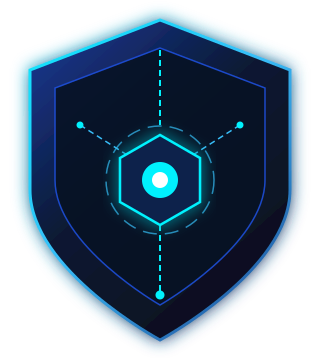
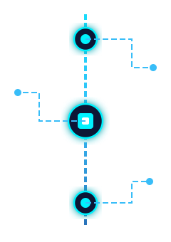
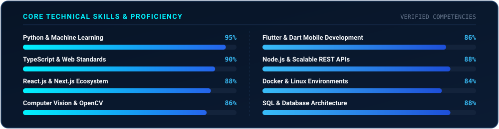
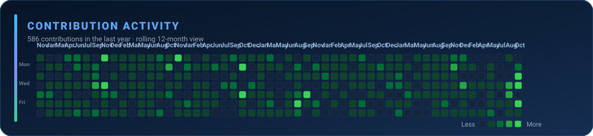
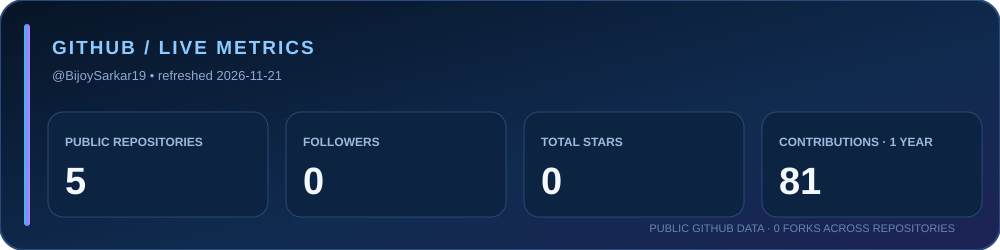
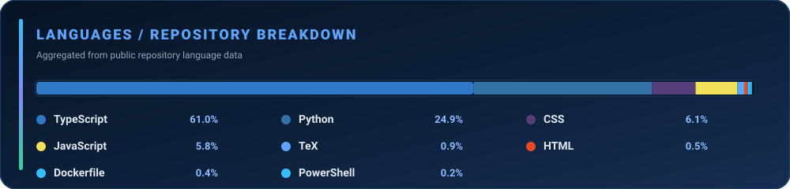
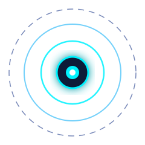

 

<!-- Interactive Live Preview Launcher -->

&nbsp;

  

# BIJOY SARKAR

### B.Tech CSE Student | Software Developer | AI/ML & Computer Vision Enthusiast
📍 **Agartala, Tripura, India**

  
  
  
  

  
  
  
  
  
  

<!-- Floating Tech Ribbon -->

  
  
  
  
  
  
  
  
  
  

---

  GET TO KNOW ME
  <h2>◈ ABOUT ME ◈</h2>

<!-- 3-Zone Layout: Bio & Metrics | Cyber Shield | Philosophy & Mission -->
<table width="100%" border="0">
<tr>
<td width="33%" valign="top">

I am a passionate software developer with extensive hands-on experience in building practical AI solutions and high-performance web applications. I love turning innovative ideas into reality through clean code, mathematical rigor, and intuitive design.

  

<table width="100%">
<tr>
<td align="center" width="50%">
  <h3>3+</h3>
  YEARS EXPERIENCE
</td>
<td align="center" width="50%">
  <h3>50+</h3>
  PROJECTS BUILT
</td>
</tr>
<tr>
<td align="center" width="50%">
  <h3>535+</h3>
  CONTRIBUTIONS
</td>
<td align="center" width="50%">
  <h3>24/7</h3>
  DEDICATED SUPPORT
</td>
</tr>
</table>

</td>

<td width="34%" align="center" valign="middle">

 
CYBER SHIELD &amp; NEURAL CORE

</td>

<td width="33%" valign="top">

### 💡 My Philosophy
Blending engineering precision with modern architectural patterns to create unique, high-performance software systems that solve real-world problems.

 

### 🎯 The Mission
Transforming complex challenges into clean, pixel-perfect, and robust interactive solutions that deliver immense value to users and organizations.

</td>
</tr>
</table>

---

  <h2>◈ CERTIFICATES &amp; EXPERIENCE ◈</h2>
  
<i>Professional achievements &amp; verified engineering credentials</i>

<table width="100%">
<tr>
<td width="50%" valign="top">

### 🛡️ Cybersecurity Intern &nbsp; `2026`
**ETDC, STQC Directorate, MeitY, Govt. of India**  
Practical security testing, vulnerability assessment, network auditing, and compliance protocols.  
`VAPT` `Network Security` `Compliance` `STQC`

</td>
<td width="50%" valign="top">

### 🤖 AI/ML Research Intern &nbsp; `2026`
**National Institute of Technology Silchar**  
Research on deep-learning vision models, neural transfer learning, and model optimization.  
`Deep Learning` `PyTorch` `Computer Vision` `Research`

</td>
</tr>
<tr>
<td width="50%" valign="top">

### 📱 App Developer Intern &nbsp; `2025`
**TalkEng, Agartala**  
Cross-platform mobile application development with real-time Firebase backend and audio streaming.  
`Flutter` `Dart` `Firebase` `REST APIs`

</td>
<td width="50%" valign="top">

### 🌐 Full-Stack Development Intern &nbsp; `2024`
**Apni Vidya, Agartala**  
Engineered responsive frontend interfaces, integrated RESTful APIs, and maintained relational databases.  
`React.js` `Node.js` `Express` `SQL`

</td>
</tr>
</table>

---

  <h2>◈ EDUCATION ◈</h2>
  
<i>My academic journey &amp; technical foundation</i>

<table width="100%">
<tr>
<td width="35%" align="center" valign="middle">

 
QUANTUM CIRCUIT DATA BUS

</td>
<td width="65%" valign="top">

### 🎓 Bachelor's in Computer Science & Engineering
**ICFAI University Tripura** · *2023 – Present*  
- Cumulative Grade: **CGPA 7.5+**
- Core Specialization: Artificial Intelligence, Machine Learning, Operating Systems, Computer Vision, Distributed Systems, and Advanced Algorithms.

 

### 🏫 Higher Secondary Education (12th Science)
**Swami Dhananjay Das Kathia Baba Mission School**  
- Focus: Physics, Chemistry, Mathematics & Computer Science.

 

### 🏫 Secondary Education (10th Standard)
**Pranavananda Vidya Mandir**  
- Graduated with First Division Distinction.

</td>
</tr>
</table>

---

  <h2>◈ FEATURED PROJECTS ◈</h2>
  
<i>My latest work &amp; intelligent systems</i>

<table width="100%">
<tr>
<td width="33%" valign="top">

### 🛡️ SentinelEdge
Privacy-first edge-to-cloud video intelligence platform featuring real-time AI object detection, multi-object tracking, and privacy-preserving inference.

`Python` `YOLO` `OpenCV` `FastAPI`

</td>
<td width="33%" valign="top">

### 🚀 CivicLens Core
Digital Municipal Corporation platform featuring geospatial GIS infrastructure mapping, AI defect risk prediction, and automated civic resolution workflows.

`TypeScript` `Next.js` `GIS` `Leaflet`

</td>
<td width="33%" valign="top">

### 🤖 Rakshak-AI
Offline conversational healthcare assistant powered by Llama 3.2 with speech recognition, BMI calculation, and encrypted SQLite storage.

`Python` `Llama 3.2` `Tkinter` `SQLite`

</td>
</tr>
<tr>
<td width="33%" valign="top">

### 🛰️ Road Segmentation
Deep-learning computer vision architecture designed to detect and segment intricate road networks from high-resolution satellite imagery.

`Python` `PyTorch` `Computer Vision` `Kaggle`

</td>
<td width="33%" valign="top">

### 👁️ Smart Attendance
Automated facial-recognition attendance pipeline delivering instant multi-face identification, anti-spoofing checks, and real-time logging.

`Python` `OpenCV` `Face Recognition`

</td>
<td width="33%" valign="top">

### 🚀 Developer Portfolio
Full-stack developer portfolio and intelligent showcase featuring interactive 300-frame canvas, dark glassmorphism, and live developer tools.

`TypeScript` `Three.js` `Tailwind` `Vercel`

</td>
</tr>
</table>

---

  <h2>◈ MY SKILLS ◈</h2>
  
<i>Technologies &amp; core competencies</i>

  

---

<h2>◈ GITHUB CONTRIBUTION ACTIVITY (535 CONTRIBUTIONS) ◈</h2>

<i>Rolling 12-month activity timeline</i>

### My Contribution Calendar

  

### 🐍 Synchronized Contribution Snake

<i>⚡ The animated cyan snake actively bites and consumes the green contribution boxes!</i>

  

### LIVE GITHUB SNAPSHOT &amp; LANGUAGES

---

  <h2>◈ RECENTLY UPDATED REPOSITORIES ◈</h2>

<!-- RECENT-REPOS:START -->

- **[SentinelEdge](https://github.com/BijoySarkar19/SentinelEdge)** — Privacy-first edge-to-cloud video intelligence platform featuring real-time AI object detection, multi-object tracking, and privacy-preserving inference.
- **[CivicLens-Core](https://github.com/BijoySarkar19/CivicLens-Core)** — Intelligent public infrastructure intelligence system for digital municipal corporations and civic authorities.
- **[BijoySarkar19](https://github.com/BijoySarkar19/BijoySarkar19)** — Personal GitHub profile README showcasing projects, technical skills, internships, and engineering journey.
- **[Bijoy-Sarkar-portfolio](https://github.com/BijoySarkar19/Bijoy-Sarkar-portfolio)** — Full-stack developer portfolio & intelligent systems showcase featuring interactive 300-frame scroll canvas and AI/ML engineering projects.
- **[Bijoy_Sarkar_CV](https://github.com/BijoySarkar19/Bijoy_Sarkar_CV)** — Professional developer curriculum vitae created using LaTeX.

<!-- RECENT-REPOS:END -->

---

<h2>◈ 🎮 PLAY LIVE: COMMIT HUNTER (SNAKE GAME) ◈</h2>

&nbsp;

Play the interactive **Commit Hunter** game directly in your browser! Collect green GitHub contribution blocks (+1) and bonus golden stars (+5) to match or beat your 535-contribution streak! Works on keyboard (Arrow keys / WASD) and touchscreens. You can also run the game locally by opening `preview.html`.

---

  <h2>◈ CONTACT ME ◈</h2>
  
<i>Get in touch for opportunities, collaborations, or engineering projects</i>

<table width="100%">
<tr>
<td width="35%" align="center" valign="middle">

 
RADAR COMM BEACON

</td>
<td width="65%" valign="middle">

📧 **Email**: [bijoysarkar7252@gmail.com](mailto:bijoysarkar7252@gmail.com)  
📍 **Location**: Agartala, Tripura, India  
💼 **Open To**: Software Developer · AI/ML Engineer · Full-Stack Developer · Entry-Level Roles  

 

</td>
</tr>
</table>

---

<h2>◈ BEYOND THE CODE ◈</h2>

<table width="100%">
<tr>
<td width="33%">

</td>
<td width="33%">

</td>
<td width="33%">

</td>
</tr>
</table>

### MY INTERESTS
🏏 Cricket · ⚽ Football · 🏸 Badminton · 🎯 Carrom · 🏋️ Gym · 🚗 Driving · 🏍️ Riding · ✈️ Travelling

 

# LET'S BUILD SOMETHING MEANINGFUL.

### Build. Learn. Improve. Repeat.

---

**BUILT WITH CURIOSITY · POWERED BY CODE · ALWAYS LEARNING**  
⭐ Thanks for visiting my GitHub profile!

