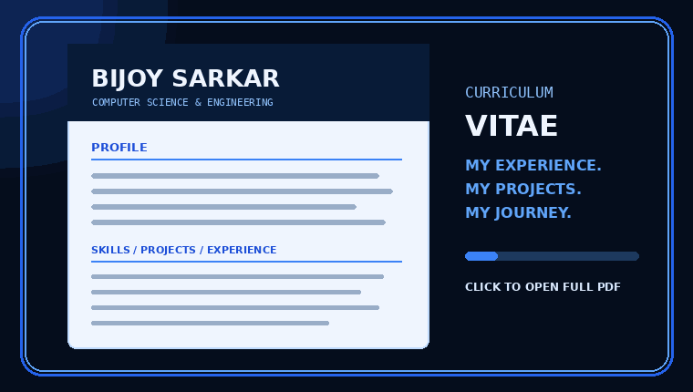

 

# BIJOY SARKAR

### B.Tech CSE Student | Software Developer | AI/ML & Computer Vision Enthusiast

📍 Agartala, Tripura, India

---

## 01 / ABOUT ME

Hello! I'm **Bijoy Sarkar**, a Computer Science & Engineering student at **ICFAI University Tripura**.

I'm passionate about building practical software solutions and exploring Artificial Intelligence, Machine Learning, Computer Vision, NLP, Full-Stack Development, Mobile App Development, and Cybersecurity.

I enjoy turning ideas into working applications, solving complex problems, and continuously improving my technical skills through real-world builds.

### WHAT I LIKE TO BUILD

<table width="100%">
<tr>
<td width="50%" valign="top">

### 🤖 AI & INTELLIGENT SYSTEMS

Machine Learning applications, Computer Vision pipelines, Natural Language Processing, and data-driven systems built with Python.

</td>
<td width="50%" valign="top">

### 🌐 WEB & APP DEVELOPMENT

Responsive web experiences, full-stack applications, and cross-platform mobile apps using JavaScript, TypeScript, Next.js, Flutter, and Firebase.

</td>
</tr>
<tr>
<td width="50%" valign="top">

### 🛡️ SOFTWARE & SECURITY

Practical software engineering, database-backed architectures, REST APIs, Docker containerization, and cybersecurity fundamentals.

</td>
<td width="50%" valign="top">

### 🧠 PROBLEM SOLVING

Strengthening Data Structures & Algorithms, writing clean maintainable code, and learning through hands-on open-source projects.

</td>
</tr>
</table>

### CURRENT FOCUS

- Data Structures & Algorithms
- Production-ready software development
- AI/ML and Computer Vision
- Scalable web and mobile applications
- Open-source contributions

### OPEN TO

Software Developer · Python Developer · AI/ML Intern · Full-Stack Developer · Entry-Level Opportunities · Internships · Collaborations · Open Source.

---

## 02 / LIVE GITHUB SNAPSHOT

---

## 03 / TECHNICAL SKILLS

### Programming Languages

### AI / Machine Learning

### Web Development

### App Development

### Databases & Tools

---

## 04 / FEATURED PROJECTS

<table width="100%">
<tr>
<td width="50%" valign="top">

### 🛡️ Rakshak-AI

AI-powered health assistant with conversational intelligence, BMI calculation, speech recognition, text-to-speech, and local data storage.

`Python` `Llama 3.2` `LM Studio` `Tkinter` `SQLite`

</td>
<td width="50%" valign="top">

### 🛰️ Road Segmentation

Computer-vision deep-learning project focused on identifying and segmenting road networks from satellite imagery.

`Python` `Jupyter` `Computer Vision` `Kaggle`

</td>
</tr>
<tr>
<td width="50%" valign="top">

### 👁️ Smart Attendance System

Face-recognition-based attendance workflow designed to automate student and employee attendance recording.

`Python` `OpenCV` `Face Recognition`

</td>
<td width="50%" valign="top">

### 📱 Expense Tracker

Cross-platform mobile application for recording and managing personal expenses with category analytics.

`Flutter` `Dart` `Firebase` `Firestore`

</td>
</tr>
<tr>
<td width="50%" valign="top">

### 😊 SentimentX

Web-based text and YouTube-comment sentiment analysis powered by NLP classifiers.

`Python` `Flask` `NLTK` `VADER` `YouTube API`

</td>
<td width="50%" valign="top">

### 🧠 Advanced NLP

Natural-language-processing experiments exploring linguistic classification on real-world datasets.

`Python` `NLP` `Jupyter` `Kaggle`

</td>
</tr>
</table>

### 🚀 CivicLens Core

An intelligent public-infrastructure intelligence platform.

- Interactive geospatial infrastructure map.
- Road and public infrastructure reporting.
- Public issue intake and automated verification.
- Historical infrastructure defect analysis.
- Executive municipal dashboards.
- AI-based infrastructure risk prediction.
- Geographic hotspot identification.
- Automatic prioritization and repair recommendations.

---

## 05 / RECENTLY UPDATED REPOSITORIES

<!-- RECENT-REPOS:START -->

- **[SentinelEdge](https://github.com/BijoySarkar19/SentinelEdge)** — Privacy-first edge-to-cloud video intelligence platform featuring real-time AI object detection, multi-object tracking, and privacy-preserving inference.
- **[CivicLens-Core](https://github.com/BijoySarkar19/CivicLens-Core)** — Intelligent public infrastructure intelligence system for digital municipal corporations and civic authorities.
- **[BijoySarkar19](https://github.com/BijoySarkar19/BijoySarkar19)** — Personal GitHub profile README showcasing projects, technical skills, internships, and engineering journey.
- **[Bijoy-Sarkar-portfolio](https://github.com/BijoySarkar19/Bijoy-Sarkar-portfolio)** — Full-stack developer portfolio & intelligent systems showcase featuring interactive 300-frame scroll canvas and AI/ML engineering projects.
- **[Bijoy_Sarkar_CV](https://github.com/BijoySarkar19/Bijoy_Sarkar_CV)** — Professional developer curriculum vitae created using LaTeX.

<!-- RECENT-REPOS:END -->

---

## 06 / EXPERIENCE

| Position | Organization | Period |
|:--|:--|:--|
| Cybersecurity Intern | ETDC, STQC Directorate, MeitY, Government of India | Jun 2026 – Jul 2026 |
| AI/ML Intern | National Institute of Technology Silchar | Jan 2026 – Mar 2026 |
| App Developer Intern | TalkEng, Agartala | Jun 2025 – Jul 2025 |
| Full-Stack Development Intern | Apni Vidya, Agartala | Jun 2024 – Aug 2024 |
| Computer Tutor | Novel Computer, Agartala | Mar 2022 – Aug 2022 |

---

## 07 / EDUCATION

**B.Tech in Computer Science & Engineering**

ICFAI University Tripura  
August 2023 – Present

**Higher Secondary Education**

Swami Dhananjay Das Kathia Baba Mission School

**Secondary Education**

Pranavananda Vidya Mandir

---

## 08 / CURRICULUM VITAE

---

## 09 / GITHUB CONTRIBUTION ACTIVITY

### MY CONTRIBUTION CALENDAR (535 CONTRIBUTIONS)

### 🐍 SYNCHRONIZED CONTRIBUTION SNAKE (535 SQUARES)

---

## 10 / 🎮 PLAY LIVE: COMMIT HUNTER (SNAKE GAME)

Play the interactive **Commit Hunter** game directly in `preview.html`! Collect green GitHub contribution blocks, grab bonus golden stars, and see if you can match the 535-contribution streak! Works on desktop keyboard (Arrow keys / WASD) and mobile touchscreens.

---

## 11 / BEYOND THE CODE

<table width="100%">
<tr>
<td width="33%">

</td>
<td width="33%">

</td>
<td width="33%">

</td>
</tr>
</table>

### MY INTERESTS

🏏 Cricket · ⚽ Football · 🏸 Badminton · 🏋️ Gym · 🚗 Driving · 🏍️ Riding · ✈️ Travelling · 🎭 Drama

---

## 12 / 🌐 SEARCH & DISCOVERABILITY (SEO)

<b>🔍 Search Engine &amp; Developer Keywords Index</b>

- **Developer Identity**: Bijoy Sarkar | BijoySarkar19 | B.Tech CSE Developer Agartala Tripura India
- **Core Specializations**: Artificial Intelligence, Machine Learning, Computer Vision, Full-Stack Development, Flutter App Development, NLP, Python Programming, Cybersecurity STQC MeitY
- **Featured Repositories**: [SentinelEdge](https://github.com/BijoySarkar19/SentinelEdge), [CivicLens-Core](https://github.com/BijoySarkar19/CivicLens-Core), [Bijoy-Sarkar-portfolio](https://github.com/BijoySarkar19/Bijoy-Sarkar-portfolio), [Bijoy_Sarkar_CV](https://github.com/BijoySarkar19/Bijoy_Sarkar_CV)
- **Verified Portfolio**: [bijoy-sarkar-portfolio.vercel.app](https://bijoy-sarkar-portfolio.vercel.app/)

---

# LET'S BUILD SOMETHING MEANINGFUL.

### Build. Learn. Improve. Repeat.

---

**BUILT WITH CURIOSITY · POWERED BY CODE · ALWAYS LEARNING**

⭐ Thanks for visiting my GitHub profile!

